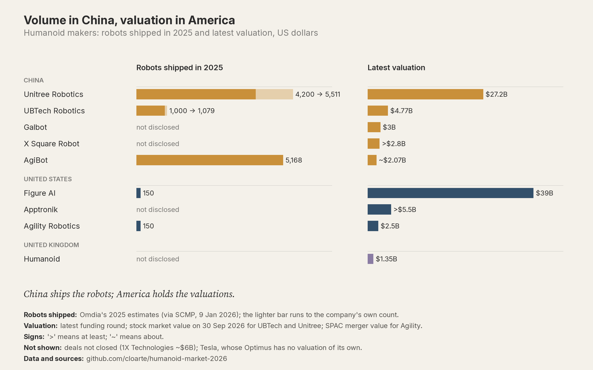

# humanoid-market-2026

[](https://github.com/cloarte/humanoid-market-2026/actions/workflows/validate.yml)

Dataset and code behind **Physical AI, by the Numbers #1 — "Volume in China, Valuation in America:
A Deep Dive into the Humanoid Robot Market"** (XBayAmauta).

The humanoid robot market is valued on a future that only one side is shipping. Chinese makers
ship most of the units; US makers hold the largest private valuations with little disclosed
deployment. This repository collects the public evidence for that claim: units shipped,
financing rounds and valuations, revenue, sector funding, forecasts, prices and costs, every public
claim that humanoid robots do useful work for a customer, and an audit of what each maker
discloses. Every number cites a public source. Data cut-off: 2026-10-12.



## Data

| file | one row is… |
|---|---|
| `data/companies.csv` | a company: country, segment, ownership |
| `data/funding_rounds.csv` | a financing round as reported by one source |
| `data/shipments.csv` | a unit count: company, year, metric, source |
| `data/valuations_revenue.csv` | a stock market value, or revenue and profit for a period |
| `data/sector_funding.csv` | total venture funding for a year, as published by a data provider |
| `data/forecasts.csv` | a published market forecast |
| `data/prices_bom.csv` | a list price, target price or cost estimate |
| `data/deployment_evidence.csv` | a public claim of robots doing useful work, and who stands behind it |
| `data/company_financial_items.csv` | a line item or statement from a filing, quoted verbatim with its page |
| `data/fx_rates.csv` | a Federal Reserve H.10 exchange rate used for conversions |

Columns, types and allowed values: [`DATA_DICTIONARY.md`](DATA_DICTIONARY.md). How the data was
selected, verified and converted: [`METHODOLOGY.md`](METHODOLOGY.md). Values not found and conflicts
between sources: [`GAPS.md`](GAPS.md).

## Charts in the article, in order

| # | chart | where |
|---|---|---|
| 1 | Volume in China, valuation in America (robots shipped and latest valuation) | `outputs/c02_units_vs_valuation.png` (and `.gif`) |
| 2 | Robotics funding hit a record by June 2026 | `outputs/c01_capital_by_year.png` (and `.gif`) |
| 3 | Valuation vs revenue (interactive) | [Datawrapper](https://datawrapper.dwcdn.net/bRoOO/), data in `outputs/dw_04_val_rev.csv` |
| 4 | Disclosure scorecard (interactive table) | [Datawrapper](https://datawrapper.dwcdn.net/77Fn6/), data in `outputs/dw_06_disclosure_scorecard.csv` |
| 5 | The cost gap | `outputs/c06_cost_curve.png` |
| 6 | Shipment forecasts vs 2025 (interactive) | [Datawrapper](https://datawrapper.dwcdn.net/CEIt5/), data in `outputs/dw_05_shipment_forecasts.csv` |

Not used in the article: latest valuations by company, [Datawrapper](https://datawrapper.dwcdn.net/p65e3/)
(`outputs/dw_03_valuations.csv`); it repeats the right-hand panel of chart 1.

## Derived figures

| command | output | what it is |
|---|---|---|
| `python -m analysis.article_figures` | `outputs/article_figures.csv` | every figure the article cites, recomputed from `data/` with the rows it uses |
| `python -m analysis.valuation_per_unit` | `outputs/valuation_per_unit.csv` | latest valuation per robot shipped in 2025: an order of magnitude, not a multiple |
| `python -m analysis.disclosure_scorecard` | `outputs/disclosure_scorecard.csv` | what each humanoid maker discloses (✓ / ◐ / ✗), each cell with its evidence |

## Reproduce

Python 3.11 or later.

```bash
python -m venv .venv
.venv/bin/pip install -r requirements-dev.txt        # Windows: .venv\Scripts\pip
python -m src.validate                                # check the data
python -m charts.all                                  # rebuild every output in outputs/
```

| command | what it does |
|---|---|
| `python -m pytest` | tests |
| `python -m src.check_urls` | is every cited page still reachable? |
| `python -m src.fx --convert AMOUNT CCY DATE` | reproduce any currency conversion |
| `python -m datawrapper.build` | create the Datawrapper charts in your own account (needs `DATAWRAPPER_API_TOKEN`; see `.env.example`) |

## Cite

See [`CITATION.cff`](CITATION.cff). Loarte Susano, Carlos (2026). *Humanoid Market 2026: an open
dataset on shipments, valuations and disclosure (Physical AI, by the Numbers #1)* (v0.1.0) [Data set].

## License

- **Code:** MIT ([`LICENSE`](LICENSE)).
- **Data in `data/` and generated files in `outputs/`:** CC BY 4.0 ([`data/LICENSE`](data/LICENSE)).
- **Bundled fonts in `assets/fonts/`:** SIL Open Font License.
